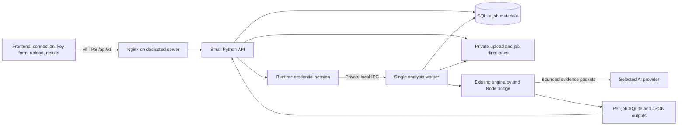

# Dedicated-server integration plan

Status: proposal only. The repository currently contains the standalone engine; none of the API, frontend integration or server configuration described below is implemented by this document.

## Outcome and order

Run the existing engine on one dedicated server and connect the separately hosted frontend to it. Deliver in this order:

1. Prove authenticated frontend/backend communication, with no AI dependency.
2. Let the user connect an AI provider through the frontend and establish one backend credential session used by analysis and any frontend AI features.
3. Transfer a supplied log, run an asynchronous analysis, and deliver evidence-linked results to the frontend.
4. Verify the complete flow on a user-supplied large file before calling it deployed.

Keep the current CLI and its private `.env` workflow available throughout. No file recovery, model training, new detection rewrite, or frontend rebuild is part of this deployment. Do not use the invalid 10k EDR dataset for acceptance.

## Proposed deployment

Use FastAPI/Uvicorn for the thin API, the existing engine as the analysis implementation, one worker, and systemd to supervise them. Use a separate SQLite database for job metadata and retain the engine's per-job analysis database. Start with one concurrent analysis; a broker, Redis, Kubernetes and multiple worker hosts are unnecessary for this first deployment. Long analysis work must run outside the HTTP request process.

Serve `/api/` through the frontend's public origin where possible. If the frontend is on a different domain, allow only that exact HTTPS origin, enable the required credentials/headers, and verify browser preflight. CORS does not authenticate a caller. The API still needs authenticated sessions and per-user ownership checks. FastAPI documents [deployment responsibilities](https://fastapi.tiangolo.com/deployment/concepts/) and [explicit CORS origins](https://fastapi.tiangolo.com/tutorial/cors/).

Initial capacity proposal: 8 vCPU, 32 GiB RAM, and 500 GiB SSD/NVMe for one active large-file job. These are starting allocations, not measured capacity guarantees. Before each job reserve space for the source, a possible decoded gzip copy, database/index growth, exports, and a safety margin. Reject admission if the reservation cannot be met; measure peak disk/RAM/time on the supplied file before adjusting concurrency or promising a maximum size. The SQLite database can be much larger than the input, depending on record count.

## Stage 1 — connect frontend and backend

Provision the server, DNS and TLS; create an unprivileged service account and private `/srv/traceweave/{uploads,jobs,state}` directories. Install Python 3.12+, Node 24+, and the engine dependencies. Put application code in a versioned release directory. Expose HTTPS through Nginx; bind the Python API to loopback. Keep application data outside the source checkout and static web root.

Define API contract version `v1`. Add `GET /api/v1/health/live`, `GET /api/v1/health/ready`, and authenticated `GET /api/v1/session`. Liveness reports that the API is alive. Readiness checks the worker heartbeat, writable storage, job database and required runtimes; it must remain independent of a user having connected an AI key. Public health responses must not expose paths, credentials or detailed host configuration.

Use the frontend's existing authenticated identity if available; otherwise put an authenticated reverse proxy in front of the deployment for this first private release. Never put a permanent service token in the JavaScript bundle. With cookie authentication, use Secure/HttpOnly session cookies and CSRF protection on mutations. Return a request ID and stable error codes from the API.

Add a small frontend connection indicator with disconnected, connecting, connected and failed states. It must call the real deployed API and display the backend version and a safe error message. Use a request/response nonce to demonstrate a fresh round trip. No engine execution or provider request is needed here.

Acceptance: the actual frontend in a browser reaches the deployed backend over HTTPS; authenticated requests succeed, expired sessions fail cleanly, and an unrelated origin/user cannot access protected resources. Stop here until communication works.

## Stage 2 — connect AI once for both sides

The user enters provider, model and key in a masked frontend form. Send these once to the backend over HTTPS. The frontend clears its key field after submission and keeps only an opaque credential-session ID and connection status. Never save the provider key in localStorage, a frontend environment variable, URLs, analytics, reports or Git. The browser will know the key while the user types it; it must not receive it back from the backend.

The backend validates an allowlisted provider/model configuration with a small provider request before reporting `connected`. Permit Groq and OpenAI through the engine's existing fixed provider endpoints; do not accept arbitrary provider URLs. The current Groq default is `openai/gpt-oss-120b`; verify availability and quota against the selected provider at connection time. The user must see the bounded evidence-sharing scope and request budget before starting analysis. Groq's [API documentation](https://console.groq.com/docs/overview) is the reference for provider integration.

Keep credentials in the API process memory, scoped to the authenticated user, with a configurable expiry (initial proposal: 24 hours). Use one API process initially so a credential session cannot disappear across unrelated API workers. Send the selected credential to the worker through an authenticated private Unix-domain channel, then into the analysis child via an anonymous pipe. Only local service processes may access this channel. Do not put credentials in job rows, command-line arguments or shared environment files. Disable request-body logging on credential routes and redact provider errors.

For server jobs, call the engine's analysis function with a job-specific AI client; do not load the CLI's `.env` or accidentally override the user's runtime provider settings. The CLI keeps its existing `.env` behavior. Keep each job's provider/model, packet budget and credential-session ID in metadata, without the key. Backend analysis and any future frontend AI action use this same credential session and server-enforced quota. The frontend calls a narrow backend AI route for a supported action; it never calls the provider directly. Result viewing itself needs no new AI request.

| Proposed route | Purpose |
|---|---|
| `POST /api/v1/ai/sessions` | Validate provider/model/key; return opaque ID, expiry and status only |
| `GET /api/v1/ai/sessions/{id}` | Return connection status and safe configuration |
| `DELETE /api/v1/ai/sessions/{id}` | Revoke the credential and cancel its queued/active jobs |

Enforce ownership on every route. On API/server restart all runtime keys are lost: jobs needing those keys become `needs_credentials`, and the user reconnects. Do not silently fall back to a shared account key. A provider failure during analysis preserves completed evidence/results and records the failure; it must not be presented as full AI completion. For the first release, interrupted analysis restarts as a new run after reconnecting; do not claim mid-file resume.

Acceptance: valid connection works, invalid/revoked keys fail clearly, neither UI responses nor stored outputs contain the key, and two authenticated users cannot use each other's credential sessions. Perform a real provider smoke check only with the user's selected provider and authorized data scope.

## Stage 3 — upload and queue the supplied log

A laptop path such as `/local/path/firex-50G.log` is not readable by a remote server. Support a resumable browser upload. An operator can alternatively pre-stage a file on the server and register it from an allowlisted input directory. Never allow an HTTP caller to pass arbitrary server paths, shell commands or download URLs.

Proposed upload contract: create an upload with filename and declared size; stream 32 MiB chunks with explicit offsets; commit only when the full byte count and server-computed SHA-256 match the expected checksum. Return the committed offset so interruptions can resume. Repeated identical chunks must be idempotent; reject conflicting offsets/content, path traversal, oversized files and writes past the declared size. Use generated server filenames and atomically finalize the source so analysis cannot read an incomplete upload. Expire abandoned chunks.

Set initial source and decoded-size quotas explicitly (proposal: 100 GiB each), plus free-space reservation and per-user quotas. Apply a decompressed-byte limit to gzip during ingestion. This requires an engine guard before serving untrusted compressed uploads. A 50 GB browser upload must not be one large JSON/base64 request or a fully buffered request body. Configure proxy and API chunk limits consistently; Nginx's [request-body size setting](https://nginx.org/en/docs/http/ngx_http_core_module.html#client_max_body_size) can otherwise reject a valid upload.

| Proposed route | Purpose |
|---|---|
| `POST /api/v1/uploads` | Allocate an owned upload ID and chunk parameters |
| `GET /api/v1/uploads/{id}` | Retrieve committed offset and upload status |
| `PUT /api/v1/uploads/{id}/chunks?offset=...` | Stream one bounded chunk to disk |
| `POST /api/v1/uploads/{id}/complete` | Verify size/checksum and finalize the source |
| `POST /api/v1/jobs` | Queue finalized upload IDs, credential-session ID and bounded options; return HTTP 202/job ID |
| `GET /api/v1/jobs/{id}` | Return state, phase, counters, heartbeat and safe error details |
| `POST /api/v1/jobs/{id}/cancel` | Request cancellation and terminate its analysis process group safely |

Persist job transitions: `queued → running → completed`; alternatives are `failed`, `cancelled`, or `needs_credentials`. Cancellation goes through `cancelling` until both Python and its Node child have stopped. Use a transactional worker claim to avoid duplicate execution, an idempotency key on job creation, immutable input IDs, and a new private output directory per run. Reconcile stale worker leases on startup. A browser disconnect must not stop a job.

Poll status every 2–5 seconds for the first implementation. Map the engine's real progress into phase and byte/record counters; do not invent progress percentages for unmeasured phases. Publish status with atomic writes, enforce runtime/resource budgets, and restrict evidence to the job owner. Keep AI data access read-only; model output must not trigger shell commands or alter baseline findings.

Acceptance: one real supplied file transfers with a matching checksum, survives an interrupted upload, queues once, keeps running after the browser closes, and cancels without leaving Node/Python children. Check disk exhaustion before and during processing.

## Stage 4 — share outputs and render the graph

Keep the engine's output contract: `summary.json`, `findings.jsonl`, `incidents.jsonl`, `evidence.jsonl`, `ai_reviews.jsonl`, `rejected.jsonl`, `sources.json`, `progress.json`, and `analysis.sqlite`. Record engine revision, source checksums, options, AI provider/model, reviewed packet counts and completion state in a versioned result manifest. An output adapter is needed; the current CLI does not already provide these HTTP endpoints or a browser graph schema.

| Proposed route | Frontend use |
|---|---|
| `GET /api/v1/jobs/{id}/summary` | Counts, coverage, AI scope and warnings |
| `GET /api/v1/jobs/{id}/findings?cursor=...` | Filtered, bounded finding pages |
| `GET /api/v1/jobs/{id}/incidents?cursor=...` | Incident list and timeline selection |
| `GET /api/v1/jobs/{id}/graph?incident_id=...&cursor=...` | Bounded nodes/edges for one selected incident |
| `GET /api/v1/jobs/{id}/evidence/{evidence_id}` | Sanitized supporting record and source locator |
| `GET /api/v1/jobs/{id}/artifacts/{name}` | Stream an allowlisted output download |

Graph responses include stable node/edge IDs, entity types, recorded relationships, evidence IDs, and `rule` versus `ai` origin. Map existing entity/relationship fields explicitly in the adapter and publish a schema version. Load one incident neighborhood at a time; return a continuation cursor and total/truncated counts. Do not ship the complete large-file database or graph into browser memory. Keep source paths private in API responses: use source IDs with filenames/checksums and controlled byte/record locators.

Show rule findings and AI hypotheses distinctly, with evidence links and supported technique/phase labels. A blocked attack, correlated candidate, accepted AI hypothesis, and independently confirmed incident must remain distinguishable. Render all log/model text as untrusted plain text. Do not expose arbitrary files through download routes; apply the same ownership checks to artifacts and evidence as to jobs. Mark partial or failed outputs visibly; publish the final manifest only after exports complete.

Acceptance: summary counts match exported counts, graph links resolve to real evidence, pagination returns no duplicate/missing IDs on immutable completed results, and downloaded files match their manifest hashes. Confirm that a second user cannot view or download the run.

## Stage 5 — operate and verify before release

Supervise Nginx, the API and the worker; restart crashed services, reconcile interrupted jobs, monitor worker heartbeats/free disk/RAM, and retain logs without keys or raw evidence. Set encrypted storage/backups and a documented retention period (proposal: seven days for uploaded sources and outputs); active jobs must be protected from cleanup. Provide explicit owned-job deletion. A deployment updates application code without deleting job data. Rollback uses the prior release and a compatible job-metadata migration; no destructive database reset.

Use only user-supplied valid logs. Run one small supplied excerpt for the real browser/API/provider path, then the requested full-size file. Record actual bytes, parsed/rejected records, checksum, runtime, peak memory/disk, AI packets/calls, accepted/rejected proposals, and completion status. Manually cross-reference a bounded set of emitted findings against their exact source records. A successful deployment proves the communication and execution flow; it does not establish 85–90% detection accuracy. That requires independently labelled ground truth and separate precision/recall measurement.

Use a short acceptance checklist and capture the above evidence with the existing outputs. Do not generate synthetic datasets or add a large new test suite. Include key revocation, wrong-owner access, interrupted upload, provider failure, worker restart and output integrity in the acceptance run because these are the material integration failure cases.

## Files to add when implementation is authorized

Keep `engine.py`, `bridge.ts`, `rules.json`, selected upstream code, requirements and notices. Add only a thin `api.py`, `worker.py`, and a deployment directory containing Nginx and systemd configuration; extend requirements for the API runtime. Put the frontend connection/key/upload/result changes in the separately maintained frontend project. Keep this plan as the contract between them. Resolve the LateralX redistribution permission recorded in `NOTICE.md` before a distributable release.

This commit adds the plan only. No server is provisioned, no API is built, no AI key is transmitted, and no deployment acceptance is claimed.

## GitHub replacement scope

Replace the current tracked files on `Z3R0x7/TraceWeave`'s default branch with the standalone engine, required support/configuration files, README, this plan, and upstream notices/source. Use one ordinary child commit so the previous application remains recoverable in commit history. Do not rewrite history or delete repository settings/issues. Preserve the separate local frontend checkout and local user logs/results. Upload `.env.example` only; exclude `.env`, virtual environments, logs, datasets, generated outputs, caches and temporary tests.
