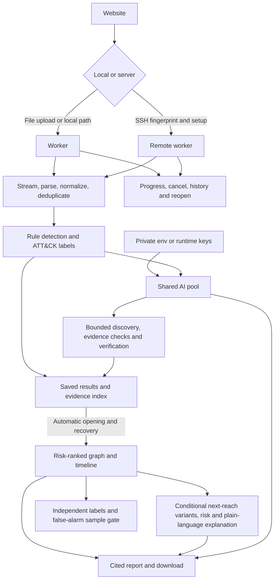

# TraceWeave

## Run

Requires macOS/Linux, Python 3.12+, Node 24+ and OpenSSH.

```sh
test -f .env || cp .env.example .env
# Add your API key(s) to .env.
sh start.command
```

Open **http://127.0.0.1:18505/**. Choose a log file or enter its backend-local path, approve bounded AI review, and click **Analyze and investigate**. Progress, cancellation, history and automatic result opening are built in.

## Add more AI keys

Keep `GROQ_API_KEY` for one key. For a pool, add this single line to `.env`, replacing both placeholders:

```dotenv
AI_CREDENTIALS_JSON=[{"label":"Primary","provider":"groq","model":"openai/gpt-oss-120b","quota_group":"my-org","key":"FIRST_KEY"},{"label":"Backup","provider":"groq","model":"openai/gpt-oss-120b","quota_group":"my-org","key":"SECOND_KEY"}]
```

Click **AI key pool → Reload keys from .env**. All AI functions share routing, retries, cooldowns and deadlines. Keys in the same organization must share a quota group; extra keys do not increase that organization's quota. A different provider/model requires explicit fallback consent.

## Use a dedicated server

Expand **Dedicated server (SSH)**. Enter host, user, key path and port. Verify and approve the fingerprint. Use **First-time setup in Terminal** once, then **Connect installed server**. Open the remote investigation at **http://127.0.0.1:18605/**.

Automatic setup supports Ubuntu 24.04+ on x86-64/ARM64 with sudo. Logs stay on the server. Disconnecting the local client does not stop remote jobs. Configure server AI keys through its UI or `/etc/traceweave/ai.env`.

## Workflow



Next reach needs real session, permission and network-policy facts. Missing facts stay unknown. A labelled synthetic walkthrough demonstrates branches and multiple hops. Risk scores are review priorities, not proof of compromise.

The false-alarm target is **under 30%**. Upload independent labels to measure it; no accuracy claim is made without them. Full-tier speed and memory still require measurement. Licence notices are included in `NOTICE.md` and the accompanying licence files.
