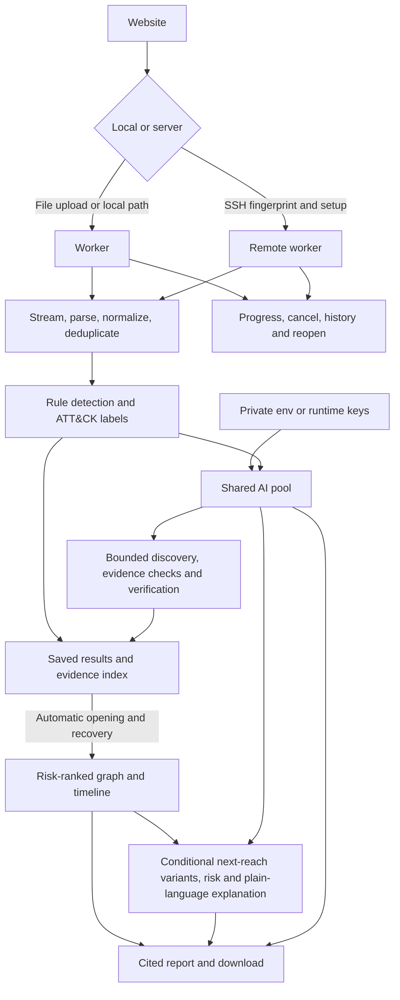

# TraceWeave

## Run

Requires macOS/Linux, Python 3.12+, Node 24+ and OpenSSH.

```sh
git clone https://github.com/Z3R0x7/TraceWeave.git
cd TraceWeave
test -f .env || cp .env.example .env
# Add your API key(s) to .env.
sh start.command
```

Open **http://127.0.0.1:18505/**. Choose a log file or enter its backend-local path, approve bounded AI review, and click **Analyze and investigate**. Progress, cancellation, history and automatic result opening are built in.

## Add more AI keys

For one Groq key, set `GROQ_API_KEY` in `.env`. For OpenAI, set `AI_PROVIDER=openai`, `AI_MODEL=gpt-4.1-mini` and `OPENAI_API_KEY`. You can also add keys in **AI key pool**; choose **OpenAI** and model **gpt-4.1-mini**. The `openai/` prefix is accepted and removed for the direct OpenAI API.

For a Groq primary with an OpenAI fallback, add this single line to `.env`, replacing the key placeholders. `fallback_enabled` authorizes that provider to receive bounded evidence:

```dotenv
AI_CREDENTIALS_JSON=[{"label":"Primary","provider":"groq","model":"openai/gpt-oss-120b","quota_group":"groq-org","key":"GROQ_KEY"},{"label":"Backup","provider":"openai","model":"gpt-4.1-mini","quota_group":"openai-org","key":"OPENAI_KEY","fallback_enabled":true}]
```

Click **AI key pool → Reload keys from .env**. All AI functions share routing, retries, cooldowns and deadlines. Keys in the same organization must share a quota group; extra keys do not increase that organization's quota. A different provider/model requires explicit fallback consent. Quota and timeout failures can use an eligible backup; short cooldowns wait within the deadline. Unavailable AI work is reported as deferred, and temporary startup capacity failures do not stop log parsing. Runtime keys stay in memory; use `.env` to keep them across app restarts.

## Use a dedicated server

Expand **Dedicated server (SSH)**. Enter host, user, key path and port. Verify and approve the fingerprint. Use **First-time setup in Terminal** once, then **Connect installed server**. Open the remote investigation at **http://127.0.0.1:18605/**.

Automatic setup supports Ubuntu 24.04+ on x86-64/ARM64 with sudo. Logs stay on the server. Disconnecting the local client does not stop remote jobs. Configure server AI keys through its UI or `/etc/traceweave/ai.env`.

## Workflow



Verified conditional access paths need real session, permission and network-policy facts. Missing facts stay unknown. Use **Possible next reach → Analyze possible next steps** for evidence-cited AI hypotheses about known hosts/accounts, with prerequisites and verification checks. A labelled synthetic walkthrough demonstrates branches and multiple hops. Risk scores are review priorities, not proof of compromise.

AI next-step hypotheses use cited logs and known entities, state prerequisites, and undergo a second evidence review. Access paths require supplied inventory. False-alarm evaluation is internal and needs independent labels; no measured accuracy is claimed. Full-tier speed and memory still require measurement. Licence notices are included in `NOTICE.md` and the accompanying licence files.
