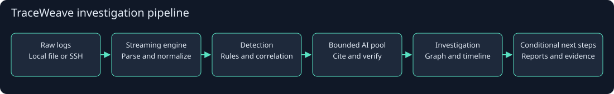
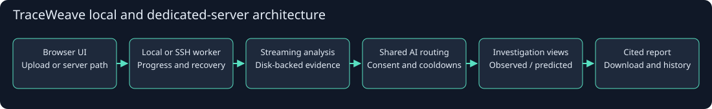

# TraceWeave · Team A42

<p align="center">
  <strong>Evidence-backed attack-path investigation for noisy security telemetry.</strong><br>
  <sub>Cyberforge final submission · Team A42</sub>
</p>

<p align="center">
  <a href="https://github.com/Z3R0x7/TraceWeave"></a>
  
</p>



## Problem statement

Security teams receive large, noisy logs but need a fast, explainable way to reconstruct suspicious activity, understand possible attack paths, and decide what to investigate next.

**TraceWeave** converts raw telemetry into a navigable investigation view with evidence-linked findings, attack-path graphs, timelines, conditional reachability, and analyst-ready reports.

## What we built

TraceWeave is a local-first investigation workstation. It combines deterministic parsing and detection with bounded AI assistance, while keeping evidence, assumptions, and uncertainty visible.

| Capability | Outcome |
| --- | --- |
| Evidence-linked findings | Every candidate connects to supporting source evidence. |
| Attack-path graph + timeline | Analysts can inspect entities, relationships, ordering, and uncertainty. |
| Deterministic-first analysis | Rules and correlation work without an AI key. |
| Guardrailed AI assistance | Bounded packets, consent, validation, retries, and safe rejection. |
| Local + SSH execution | Run locally or beside large logs on a dedicated server. |
| Analyst-ready output | Risk-ranked candidates, conditional reach, reports, and run history. |

## Functional requirements included

| Requirement | Included |
| --- | --- |
| **FR1 · Ingest** | Local files, backend paths, output folders, chunked uploads, and source confinement. |
| **FR2 · Normalize + quality** | Streaming parsing, canonical entities, deduplication, counts, progress, cancellation, and partial artifacts. |
| **FR3 · Detect + explain** | Rule findings, ATT&amp;CK labels, kill-chain interpretations, uncertainty, and evidence references. |
| **FR4 · AI review** | Shared Groq/OpenAI routing, bounded packets, consent, validation, retries, and safe abstention. |
| **FR5 · Attack-path view** | Risk-ranked candidates, graph, timeline, relationship inspector, and evidence navigation. |
| **FR6 · Next reach** | Permission/network-policy intersection with explicit unknowns and conditional results. |
| **FR7 · Application** | Browser UI, jobs, cancellation, history, recovery, reports, and dedicated-server workflow. |

## Bonus included

| Bonus | Included |
| --- | --- |
| **B1 · Heuristic ranking** | Transparent triage factors; score is not compromise probability. |
| **B2 · Reports** | Cited deterministic reports plus an optional validated AI draft path. |
| **B3 · Raw-record counts** | Source, parsed, normalized, rejected, duplicate, finding, and quality counts. |
| **Remote scale path** | SSH fingerprint approval, server setup, remote worker, and local access. |
| **Shared AI control plane** | One bounded pool for detection, review, drafting, and health checks. |

## Architecture



<sub>GitHub-safe architecture graphic: the full pipeline is rendered as an image instead of relying on Mermaid support in the viewer.</sub>

**Flow:** raw telemetry → streaming engine → quality gates → evidence index → detections → candidate graph/timeline → conditional reach → guarded AI validation → cited report.

The UI distinguishes observed, inferred, and predicted relationships so a plausible path is never presented as a confirmed attack.

## Quick start

Requirements: macOS/Linux, Python 3.12+, Node 24+, and OpenSSH.

```bash
git clone https://github.com/Z3R0x7/TraceWeave.git
cd TraceWeave
cp .env.example .env
# Add provider credentials only if AI review is wanted.
sh start.command
```

Open [http://127.0.0.1:18505/](http://127.0.0.1:18505/).

1. Select log files or enter backend-local paths.
2. Approve bounded AI review if required.
3. Click **Analyze and investigate**.
4. Inspect a candidate through **Attack path → Possible next reach → Report**.

For large inputs, use **Dedicated server (SSH)**. The local private key stays on the client; logs stay on the server; disconnecting the client does not stop an active remote job.

## Demo

The repository includes a clearly labelled synthetic path/reach walkthrough at `website/demo.json`. Use it to demonstrate graph navigation, timeline review, evidence inspection, conditional reachability, and report generation.

## Trust boundary

- A finding is suspicious activity, not a confirmed attack.
- Timestamp conflicts do not establish causality.
- ATT&amp;CK and kill-chain labels are interpretations unless directly observed.
- A permitted next-reach path is not a live connectivity test.
- AI receives bounded sanitized evidence previews only after consent.
- Unsupported AI claims are rejected.
- The false-alarm target is **under 30%**, pending independent labels.

## License and notices

See [`NOTICE.md`](NOTICE.md) and [`MITRE_LICENSE.txt`](MITRE_LICENSE.txt). Third-party normalization licensing is included under [`vendor/normalization/LICENSE`](vendor/normalization/LICENSE).
